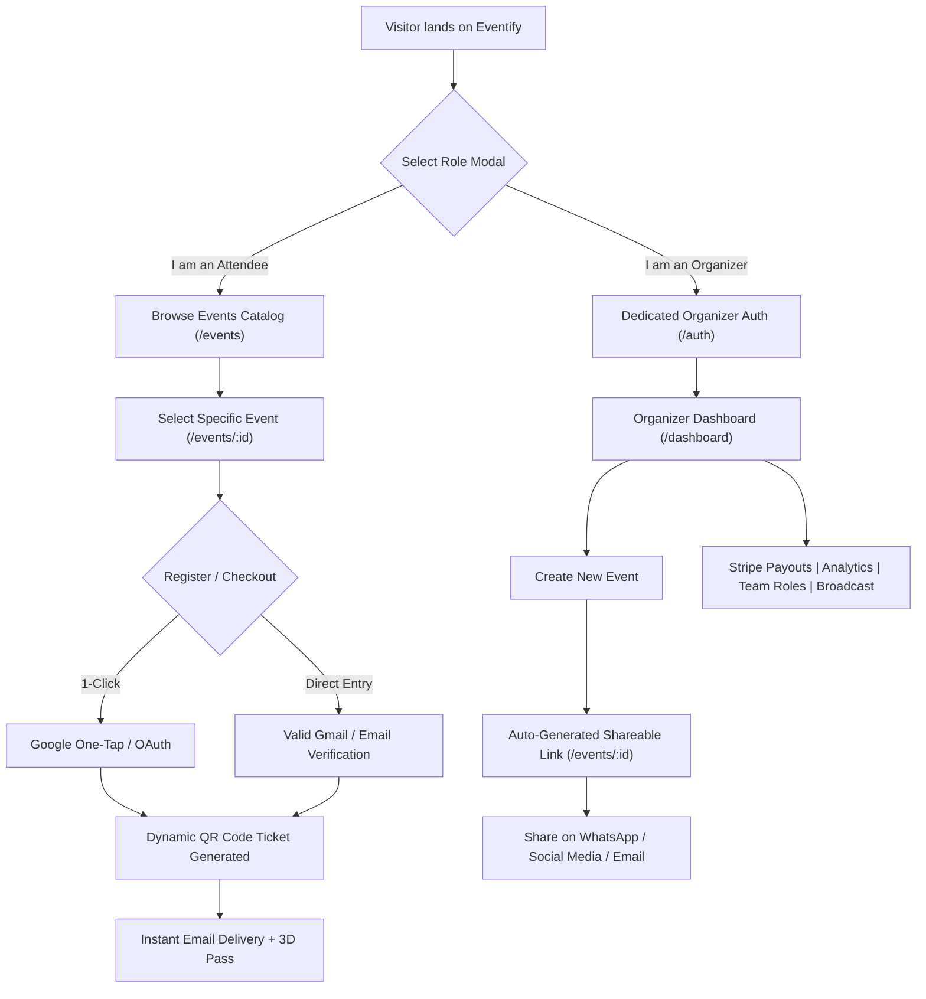
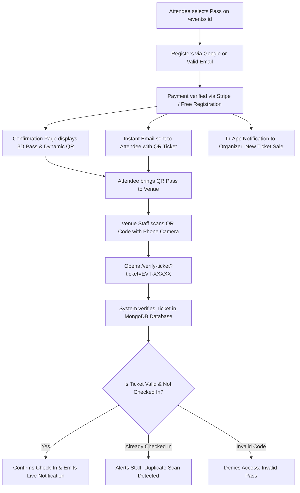

# 🎟️ Eventify — Smart Event Management & Digital Ticketing Platform

[](https://nextjs.org/)
[](https://react.dev/)
[](https://tailwindcss.com/)
[](https://www.mongodb.com/)
[](https://stripe.com/)
[](https://ai.google.dev/)
[](https://eventify-tawny-one.vercel.app/)

> **Eventify** is a next-generation Event Management and Digital Ticketing Platform built with **Next.js 16 (App Router)**, **MongoDB Atlas**, **Stripe**, and **Google Gemini AI**. Designed with a seamless separation between Attendees (zero login barrier, direct event discovery, 1-click Google/Gmail registration) and Organizers (dedicated management portal, shareable event links, live analytics, and Stripe Connect payouts).

🌐 **Live Website**: [https://eventify-tawny-one.vercel.app/](https://eventify-tawny-one.vercel.app/)

---

## 📸 Screenshots & UI Preview

| Landing Page (Hero) | 3D Interactive Pass Engine |
| :---: | :---: |
|  |  |

| Discover Events Catalog | Event Details & Ticket Checkout |
| :---: | :---: |
|  |  |

| Dedicated Organizer Dashboard | Venue QR Check-In Scanner |
| :---: | :---: |
|  |  |

<details>
<summary><b>🔍 View Full Landing Page Preview</b></summary>

<br />


</details>

---

## 🚀 Two Distinct User Journeys



### 1. 🎟️ For Attendees: Zero Login Barrier & Instant Access
- **No Mandatory Account Creation**: Attendees do not need to register an account or remember passwords to explore public events.
- **Direct Event Exploration (`/events`)**: Instant access to the public event catalog, category filters, and live search.
- **Flexible Event Registration**:
  - **1-Click Google Sign-In**: Quick authentication without filling tedious forms.
  - **Manual Email Entry**: Accepts any valid Gmail/email address with strict regex validation (`/^[a-zA-Z0-9._%+-]+@[a-zA-Z0-9.-]+\.[a-zA-Z]{2,}$/`).
- **Instant QR Pass**: Dynamic encrypted QR pass generated on the confirmation screen and delivered directly to the attendee's inbox via Nodemailer.
- **Interactive 3D Ticket Pass**: Three.js WebGL holographic pass with orbital rotation.

### 2. ⚡ For Organizers: Powerful Management & Automated Link Sharing
- **Dedicated Organizer Portal (`/auth`)**: Clean, exclusive organizer authentication (email/password and Google OAuth). Attendee login prompts are completely removed to prevent confusion.
- **Auto-Generated Shareable Event Links**: When an organizer publishes an event in `/dashboard`, the system immediately generates a unique shareable link (`https://eventify.app/events/[id]`) with a 1-click copy link modal.
- **Real-Time Revenue & Attendance Analytics**: Visual charts for ticket sales, revenue growth, and check-in rates.
- **Stripe Connect Automated Payouts**: Connect bank accounts and receive automated multi-currency ticket payouts (`PKR`, `USD`, `EUR`, `GBP`).
- **Team Roles & Scanner Delegation**: Assign staff scanner permissions to team members via `/dashboard/roles` and `/verify-ticket`.
- **Broadcast Messaging**: Send bulk update emails to all registered event attendees in one click.

---

## 🌟 Key Platform Features

### 1. 🤖 Intelligent Bilingual AI Assistant (Google Gemini)
- **Fluent in English & Roman Urdu**: Understands and replies naturally in English and Roman Urdu (e.g., *"Event ki ticket price kya hai?", "Ticket kaise verify hogi?"*).
- **Live Database Search**: Real-time queries for upcoming events, dates, venues, categories, and ticket tier pricing.
- **Context-Aware Navigation**: Guides users with direct action links to event pages and ticket scanners without forcing attendee logins.

### 2. 🛡️ Interactive Camera QR Code Scanner & Dual Verification (`/verify-ticket`)
- **Live Camera QR Viewfinder**: Integrated with `Html5Qrcode` featuring a live viewfinder, animated glowing laser scanning beam, and reticle targeting.
- **Smart Camera Detection**: Automatically selects the smartphone's rear environment camera (`facingMode: "environment"`), with front/back camera switching and photo gallery QR upload fallback.
- **Dual-Mode Verification Desk**:
  - **Mode 1 — Live Camera Scanning**: Point camera at attendee's digital pass or printed QR code for sub-second recognition.
  - **Mode 2 — Manual Code Entry**: Fallback input allowing staff to type unique ticket codes (`EVT-XXXXX` or Order IDs) with instant pass unlock.
- **Role-Based Gate Security**: Automatically recognizes authorized gate staff and organizers via session lookup (`findTeamRoleForEventAndUser`), enabling 1-tap entrance check-in controls while keeping sensitive revenue data hidden.
- **Anti-Fraud Duplicate Prevention**: Instantly alerts staff with prominent warning banners if a pass was already scanned (`⚠️ Already Checked In at [Time]`).
- **Web Audio & Haptic Feedback**: Dynamic confirmation chimes (via Web Audio API) and vibration patterns on smartphones for rapid gate queue throughput.

### 3. 🔔 Real-Time In-App Notification Center
- **Interactive Notification Bell**: Integrated across the Organizer Dashboard, Events Catalog, and Navigation Bars.
- **Instant Alerts**:
  - **Ticket Sales**: Emits real-time alerts to the organizer (*"New Ticket Sale! [Name] bought a pass"*).
  - **Check-In Confirmations**: Live entrance alerts for checked-in attendees.
- **Unread Badge & Filters**: Live polling counter badge, pulse animations, filter tabs ("All" / "Unread"), and individual "Mark as Read" actions.

### 4. 💳 Multi-Currency Stripe Checkout & Gateways
- **Stripe Hosted Checkout**: Secure credit/debit card processing with dynamic currency conversion (PKR, USD, EUR, GBP, AED, SAR).
- **Asynchronous Webhooks (`/api/webhooks/stripe`)**: Automated order fulfillment, ticket generation, and real-time inventory deduction upon successful payment.

### 5. 🌟 Real Platform Metrics & Live Community Reviews
- **Database-Driven Statistics**: Landing page metrics (Total Events, Passes Booked, Average Community Rating) calculated dynamically from MongoDB.
- **Live Community Reviews Engine**: Real feedback fetched via `/api/reviews` with 1-5 star ratings, verified attendee badges, event tags, and reviewer avatars.
- **Interactive "Write a Review" Modal**: Attendees and creators can submit ratings and feedback with real-time UI updates.

### 6. ⚡ Platform-Wide Real-Time Auto-Refresh & Background State Sync
- **Zero Browser Reloads**: Eliminates the need for users, attendees, or organizers to press the browser refresh button.
- **Silent Background Polling (10-12s) + Window Focus Revalidation**:
  - **Public Events Catalog (`/events`)**: Automatically refreshes when organizers publish or edit events, or when ticket tiers sell out.
  - **Individual Event Details (`/events/[id]`)**: Live seat availability, tier changes, and schedule updates sync silently in the background.
  - **Main Landing Page (`/`)**: Live database platform metrics and community reviews engine update without reload.
  - **Organizer Management Hub (`/dashboard/*`)**: Live revenue numbers, ticket sales count, check-in stats, guestlist, staff roles, and orders update silently without page flicker or skeleton reloads.
  - **Global Notification Bell**: Real-time counter and alert synchronization.

### 7. 📧 High-Deliverability Transactional Email Engine
- **Multipart/Alternative Architecture**: Dispatches both human-readable plain text (`text: ...`) and responsive HTML bodies across all emails (ticket passes, team invitations, broadcasts, OTPs) to maximize Primary Inbox placement and eliminate Gmail spam triggers.
- **Standard RFC Deliverability Headers**: Configured with `X-Mailer`, `X-Priority: 1`, `Importance: high`, and `Reply-To` headers.
- **Team Role Delegation Invites**: Automated invitation emails featuring assigned position titles, an authority checklist with green checkmarks (`✓`), and 1-click action buttons leading straight to the gate check-in desk (`/verify-ticket`).
- **Dynamic Scannable Pass Delivery**: Instant order confirmation emails with scannable QR ticket passes and event logistics.

---

## 🛠️ Tech Stack & Architecture

| Layer | Technology | Details |
| :--- | :--- | :--- |
| **Frontend Framework** | **Next.js 16.2.6 (App Router)** | React 19, Server & Client Components, Turbopack |
| **Styling & Design** | **Tailwind CSS v4** | CSS Variables, Dark/Light Mode with `next-themes`, Glassmorphism |
| **3D & Visuals** | **Three.js & Lucide Icons** | Interactive 3D WebGL scene canvas, OrbitControls, GSAP |
| **Database** | **MongoDB Atlas** | Official `mongodb` & `mongoose` drivers with connection pooling |
| **Payment Gateway** | **Stripe API & Stripe Connect** | Hosted Checkout Sessions, Webhooks, Multi-Currency Payouts |
| **Artificial Intelligence**| **Google Gemini AI** | Official `@google/genai` SDK, Function Calling, Bilingual Prompting |
| **Email Service** | **Nodemailer** | Gmail SMTP transport with HTML ticket templates & scannable QR passes |
| **Authentication** | **Custom JWT + Google Identity (GIS)** | Bcrypt password hashing, HTTP-Only cookies, Google One-Tap |
| **Deployment** | **Vercel** | Edge Network, Serverless Route Handlers |

---

## 📁 Project Structure

```text
eventify/
├── docs/
│   └── screenshots/          # UI preview images for documentation
├── public/                   # Static assets, logos, and illustrations
├── src/
│   ├── app/                  # Next.js App Router
│   │   ├── admin/            # Platform administration (users, roles, metrics)
│   │   ├── api/              # Serverless backend API routes
│   │   │   ├── auth/         # Login, register, Google OAuth, OTP verification
│   │   │   ├── chat/         # Gemini AI chatbot endpoint (bilingual search)
│   │   │   ├── events/       # Events CRUD, checkout sessions, ticket dispatch
│   │   │   ├── notifications/ # Real-time notification fetch & status update
│   │   │   ├── organizer/    # Dashboard metrics, settings, broadcast, attendees
│   │   │   ├── reviews/      # Live community reviews & platform metrics
│   │   │   ├── stripe/       # Stripe checkout sessions & verification
│   │   │   ├── verify-ticket/ # QR ticket scanner & entrance check-in
│   │   │   └── webhooks/     # Stripe asynchronous payment webhook handler
│   │   ├── auth/             # Dedicated Organizer Login & Registration
│   │   ├── dashboard/        # Organizer management dashboard & analytics
│   │   │   ├── analytics/    # Revenue and attendance analytics
│   │   │   ├── attendees/    # Registered attendee guestlist & export
│   │   │   ├── events/       # Event creation with auto-link generator modal
│   │   │   ├── registrations/ # Order tracking & CSV export
│   │   │   ├── roles/        # Staff scanner permissions & team delegation
│   │   │   ├── settings/     # Profile, Stripe Connect payout, 2FA, notifications
│   │   │   └── layout.js     # Organizer role protection guard
│   │   ├── events/           # Public Discover events catalog
│   │   │   └── [id]/         # Specific event details, 3D pass, Google/Email booking
│   │   ├── portal/           # Operational Portal (Dashboard & Ticket Scanner)
│   │   ├── verify-ticket/    # Public QR pass entrance scanner desk
│   │   ├── layout.js         # Global layout with theme provider & chatbot
│   │   ├── page.js           # Landing page with role selector modal & 3D pass hero
│   │   └── proxy.js          # Next.js middleware & route protection
│   ├── components/           # Reusable UI components
│   │   ├── ui/               # Buttons, inputs, dialogs, badges, cards
│   │   ├── Chatbot.js        # Gemini AI assistant widget
│   │   ├── Eventify3DScene.jsx # Three.js interactive 3D event pass
│   │   ├── NotificationBell.js # Live notification dropdown & polling badge
│   │   ├── Sidebar.js        # Organizer navigation sidebar
│   │   └── theme-toggle.js   # Dark/Light theme switcher
│   └── lib/                  # Core utilities and backend libraries
│       ├── auth.js           # JWT creation, verification, cookie helpers
│       ├── currencies.js     # Live currency exchange rates & formatting
│       ├── db.js             # Database CRUD abstraction & persistent storage
│       ├── email.js          # Nodemailer ticket email & OTP dispatcher
│       ├── gemini.js         # Google Gemini client configuration
│       ├── mongodb.js        # MongoDB Atlas client singleton
│       └── stripe.js         # Stripe SDK client initialization
├── package.json              # Project dependencies and scripts
└── tailwind.config.js        # Tailwind styling configuration
```

---

## ⚙️ Environment Configuration

Create a `.env` or `.env.local` file in the root directory:

```env
# Application URL
NEXT_PUBLIC_APP_URL=https://eventify-tawny-one.vercel.app

# MongoDB Atlas Connection
MONGODB_URI=mongodb+srv://<username>:<password>@cluster0.fbjmeqo.mongodb.net/eventify?retryWrites=true&w=majority

# Nodemailer / Email Service (Gmail SMTP)
EMAIL_USER=your_email@gmail.com
EMAIL_PASSWORD=your_gmail_app_password

# Google OAuth 2.0 Credentials (GIS)
NEXT_PUBLIC_GOOGLE_CLIENT_ID=your_google_client_id.apps.googleusercontent.com

# Stripe Payment Gateway & Connect
STRIPE_SECRET_KEY=sk_test_...
NEXT_PUBLIC_STRIPE_PUBLISHABLE_KEY=pk_test_...
STRIPE_WEBHOOK_SECRET=whsec_...

# Google Gemini AI API Key
GEMINI_API_KEY=your_gemini_api_key

# JWT Secret
JWT_SECRET=your_super_secret_jwt_key
```

> [!NOTE]
> For Gmail SMTP, generate an **App Password** from your Google Account settings (*Security → 2-Step Verification → App Passwords*).

---

## 🚀 Getting Started Locally

### 1. Clone the Repository
```bash
git clone https://github.com/ABDROJR20/eventify.git
cd eventify
```

### 2. Install Dependencies
```bash
npm install
```

### 3. Run the Development Server
```bash
npm run dev
```

Open [http://localhost:3000](http://localhost:3000) in your browser.

### 4. Build for Production
```bash
npm run build
npm run start
```

---

## 🛡️ Verification & Venue Check-In Flow



---

## 🌐 Deploying to Vercel

1. Push your changes to **GitHub**.
2. Go to the [Vercel Dashboard](https://vercel.com/) and import `eventify`.
3. In **Settings → Environment Variables**, add the environment variables defined above.
4. Click **Deploy**. Vercel will automatically build and publish your project!

---

## 📄 License

This project is licensed under the **MIT License**.

Developed with ❤️ by **Abdullah Munawar** & the Eventify Team.
