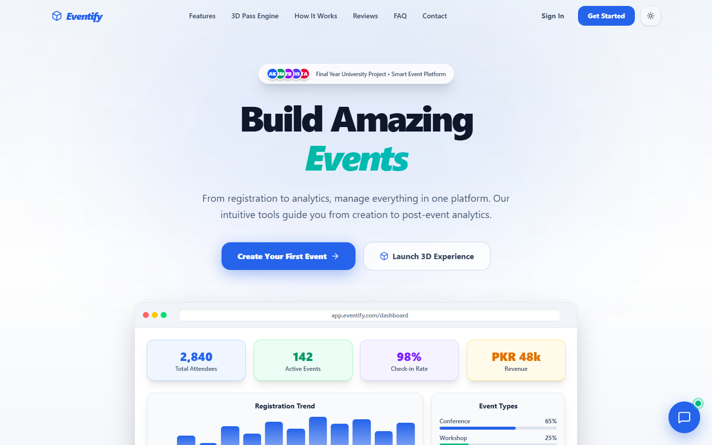
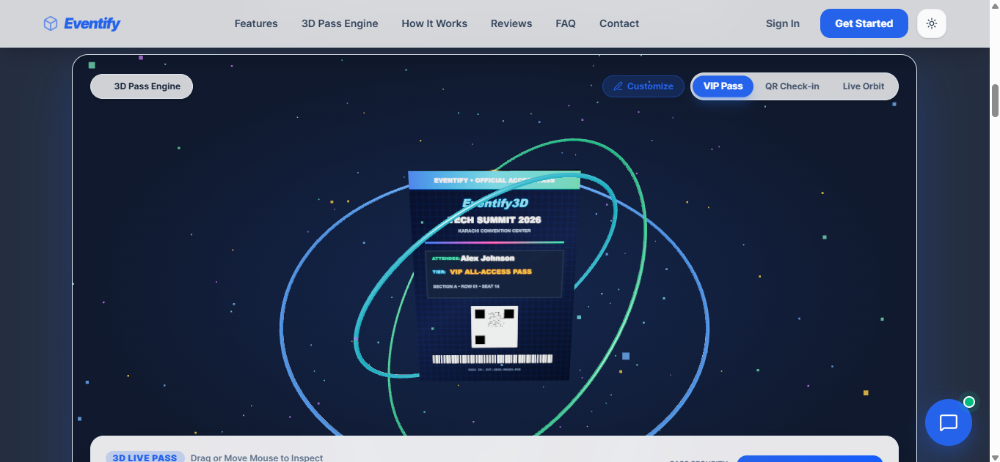
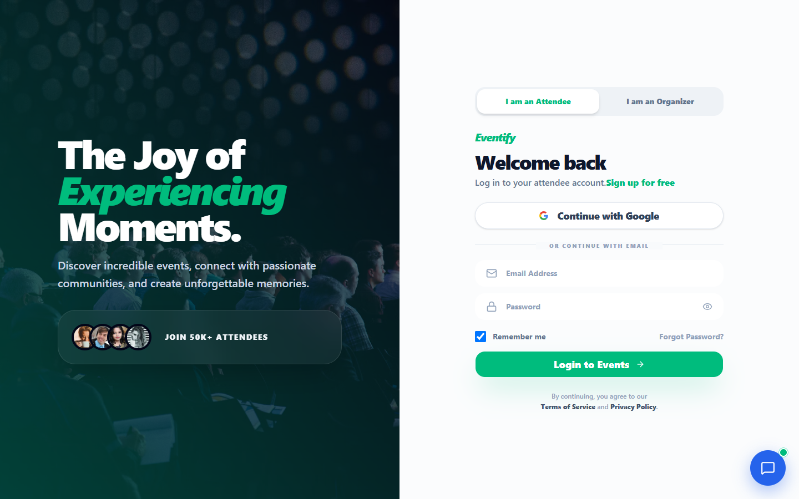
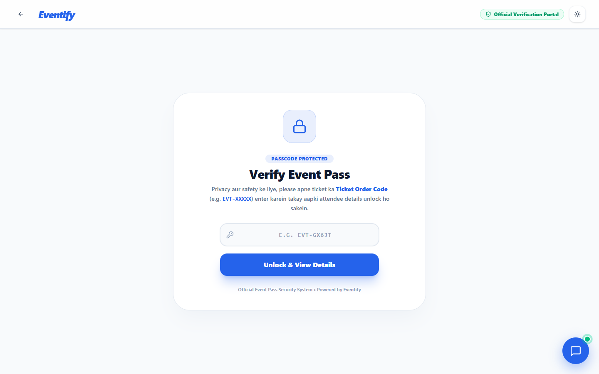
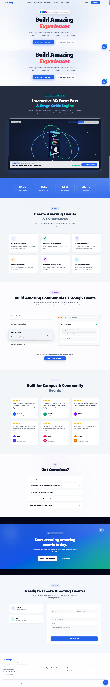
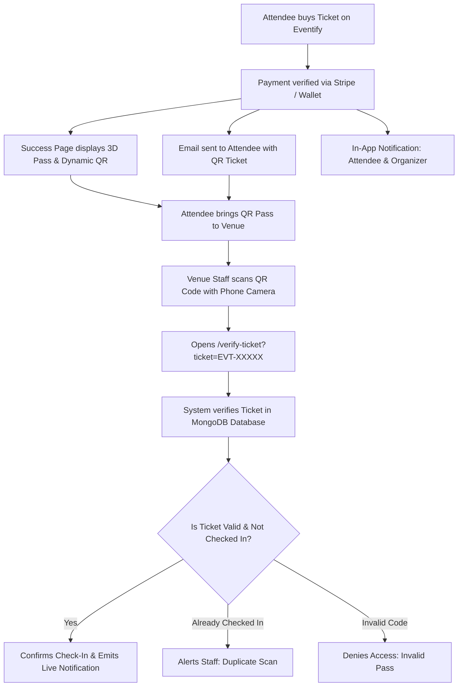

# 🎟️ Eventify — Smart Event Management & Ticket Booking Platform

[](https://nextjs.org/)
[](https://react.dev/)
[](https://tailwindcss.com/)
[](https://www.mongodb.com/)
[](https://stripe.com/)
[](https://ai.google.dev/)
[](https://eventify-tawny-one.vercel.app/)

> **Eventify** is a modern Event Management and Digital Ticketing Platform built with **Next.js 16 (App Router)**, **MongoDB Atlas**, **Stripe**, and **Google Gemini AI**. It features interactive 3D WebGL event passes, dynamic QR code ticket validation, real-time in-app notifications, an intelligent bilingual AI assistant (English & Roman Urdu), automated Stripe Connect payout infrastructure, and role-protected organizer dashboards.

🌐 **Live Website**: [https://eventify-tawny-one.vercel.app/](https://eventify-tawny-one.vercel.app/)

---

## 📸 Screenshots & UI Preview

| Landing Page (Hero) | 3D Interactive Pass Engine |
| :---: | :---: |
|  |  |

| Discover Events Catalog | Event Details & Ticket Checkout |
| :---: | :---: |
|  |  |

| Attendee & Organizer Portal | Venue QR Check-In Scanner |
| :---: | :---: |
|  |  |

<details>
<summary><b>🔍 View Full Landing Page Preview</b></summary>

<br />



</details>

---

## 🌟 Key Features

### 1. 🤖 Intelligent Bilingual AI Assistant (Google Gemini)
- **Natural Language in English & Roman Urdu**: Converses fluently in both English and Roman Urdu (e.g., *"Event ki price kya hai?", "Ticket kaise verify hogi?"*).
- **Live Event Search & Discovery**: Queries the database in real time for upcoming workshops, summits, dates, venues, and ticket tier pricing.
- **Direct Navigation Links**: Provides action buttons and links that take users directly to event booking pages or prompt sign-in if needed.
- **Clean Markdown Formatting**: Clean, professional responses free from raw syntax glitches.

### 2. 🔔 Real-Time In-App Notification Bell System
- **Live Notification Center**: Interactive notification bell integrated across the Organizer Dashboard, Events Catalog, and Attendee Portal.
- **Instant Alerts**:
  - **Ticket Purchases**: Emits real-time alerts to the attendee (*"Ticket Confirmed! Pass EVT-XXXXX is ready"*) and the organizer (*"New Ticket Sale! [Name] bought a pass"*).
  - **Venue Check-In**: Alerts the organizer upon badge verification and welcomes the attendee upon entry.
- **Live Polling & Badge Counter**: Unread counter badge, pulse animations, filter tabs ("All" / "Unread"), and individual "Mark as Read" actions.

### 3. ⚙️ Comprehensive Organizer Settings & Stripe Connect
- **Profile Customization**: Live avatar photo upload and preview, organizer/company name, email, bio, and social media links.
- **Stripe Connect Payouts**:
  - Live Stripe account connection status (`Connected` badge & Account ID).
  - Payout currency selection (`PKR`, `USD`, `EUR`, `GBP`).
  - Instant Payouts toggle switch and linked bank account management (IBAN / routing).
- **Notification Preferences**: Granular switches for ticket sales alerts, daily digest summaries, marketing emails, and audio chimes.
- **Security & Authentication**:
  - **Master Password Change**: Secure current password validation with `bcrypt` encryption.
  - **Google OAuth Compatibility**: Intelligently detects accounts registered via Google and allows setting a local password directly without requiring an existing password.
  - **Two-Factor Authentication (2FA)**: Toggleable extra layer of defense with email OTP verification.

### 4. 🎫 Interactive 3D Passes & Dynamic QR Ticketing
- **Three.js WebGL 3D Pass**: Interactive pass card featuring 360° orbital rotation, stage lighting effects, and holographic badge seals.
- **Dynamic Scannable QR Codes**: Every purchased ticket generates an encrypted ticket code (`EVT-XXXXX`).
- **Venue Check-in Desk (`/verify-ticket`)**: Sub-second attendee validation using camera QR scanning or manual code search with duplicate check-in prevention.
- **Automated Email Delivery**: Instant confirmation emails with scannable QR ticket attachments dispatched via Nodemailer.

### 5. 🔐 Strict Role-Based Authentication & Protected Routes
- **Attendee vs. Organizer Separation**: Distinct authentication flows preventing attendees from accessing organizer panels and vice-versa.
- **JWT & HTTP-Only Cookies**: Secure session token storage protected against client-side script tampering.
- **Google OAuth 2.0 Integration**: Fast single-click Google authentication with automated account creation.
- **OTP Password Recovery**: 6-digit email verification flow for secure password resets.

### 6. 💳 Multi-Currency Stripe Checkout & Payment Gateways
- **Stripe Hosted Checkout**: Secure credit/debit card processing with automatic exchange rate conversion.
- **Multi-Currency Support**: Dynamic price display across PKR, USD, EUR, GBP, AED, and SAR.
- **Automated Webhooks**: Stripe webhook listener (`/api/webhooks/stripe`) for instant order fulfillment and inventory adjustment.

### 7. 🌟 Real Platform Metrics & Live Community Reviews
- **Real Database-Driven Metrics**: Replaced static/fake stats. Landing page metrics (Total Events, Passes Booked, Average Community Rating, and Verification Accuracy) are computed dynamically from MongoDB and real database state.
- **Live Community Reviews Engine**: Real feedback fetched dynamically via `/api/reviews` with 1-5 star ratings, verified attendee badges, event tags, and reviewer avatars.
- **Interactive "Write a Review" Modal**: Attendees and creators can submit their genuine ratings and feedback directly through an interactive modal with instant live updates.

---

## 🛠️ Tech Stack & Architecture

| Layer | Technology | Details |
| :--- | :--- | :--- |
| **Frontend Framework** | **Next.js 16.2 (App Router)** | React 19, Server & Client Components, Turbopack |
| **Styling & Design** | **Tailwind CSS v4** | CSS Variables, Dark/Light Mode with `next-themes`, Glassmorphism |
| **3D & Animations** | **Three.js & Lucide Icons** | Interactive 3D WebGL scene canvas, Framer Motion, GSAP |
| **Database** | **MongoDB Atlas** | Official `mongodb` & `mongoose` drivers with serverless connection caching |
| **Payment Gateway** | **Stripe API** | Hosted Checkout Sessions, Webhooks, Stripe Connect Payouts |
| **Artificial Intelligence**| **Google Gemini AI** | Official `@google/genai` SDK, Function Calling, System Prompts |
| **Email Service** | **Nodemailer** | Gmail SMTP transport with HTML templates and QR ticket delivery |
| **Authentication** | **Custom JWT + Google OAuth** | BcryptJS password hashing, HTTP-Only cookies, Google Identity |
| **Deployment** | **Vercel** | Edge network, Serverless API functions |

---

## 📁 Project Structure

```text
eventify/
├── docs/
│   └── screenshots/        # UI preview images for documentation
├── public/                 # Static assets, logos, and illustrations
├── src/
│   ├── app/                # Next.js App Router
│   │   ├── admin/          # Admin management (users, roles, analytics, alerts)
│   │   ├── api/            # Serverless backend API endpoints
│   │   │   ├── auth/       # Login, register, Google OAuth, OTP verification
│   │   │   ├── chat/       # Gemini AI chatbot endpoint (bilingual search)
│   │   │   ├── events/     # Events CRUD, checkout sessions, ticket dispatch
│   │   │   ├── notifications/ # Real-time notification fetch, read, & delete
│   │   │   ├── organizer/  # Dashboard metrics, settings, broadcast, attendees
│   │   │   ├── reviews/    # Live community reviews & platform metrics endpoint
│   │   │   ├── stripe/     # Stripe checkout sessions & verification
│   │   │   ├── verify-ticket/ # QR ticket scanner & entrance check-in
│   │   │   └── webhooks/   # Stripe asynchronous payment webhook handler
│   │   ├── auth/           # Login, signup, & password reset flows
│   │   ├── dashboard/      # Organizer management dashboard & settings
│   │   │   ├── analytics/  # Revenue and attendance analytics
│   │   │   ├── attendees/  # Registered attendee guestlist
│   │   │   ├── events/     # Event creation and management
│   │   │   ├── registrations/ # Order tracking & CSV export
│   │   │   ├── settings/   # Profile, Stripe payout, notifications, 2FA
│   │   │   └── layout.js   # Organizer role protection guard
│   │   ├── events/         # Discover events catalog & ticket booking [id]
│   │   ├── portal/         # Role selection portal (Attendee / Organizer)
│   │   ├── verify-ticket/  # Public QR pass entrance scanner
│   │   ├── layout.js       # Global layout with theme provider & chatbot
│   │   └── page.js         # Landing page with 3D pass hero & featured events
│   ├── components/         # Reusable UI components
│   │   ├── ui/             # Buttons, inputs, badges, cards, tables
│   │   ├── Chatbot.js      # Gemini AI assistant widget
│   │   ├── Eventify3DScene.jsx # Three.js interactive 3D event pass
│   │   ├── NotificationBell.js # Live notification dropdown & polling badge
│   │   ├── Sidebar.js      # Organizer navigation sidebar
│   │   └── theme-toggle.js # Dark/Light theme switcher
│   └── lib/                # Core utilities and backend libraries
│       ├── auth.js         # JWT creation, verification, cookie helpers
│       ├── currencies.js   # Live currency rates & formatting
│       ├── db.js           # Database CRUD abstraction & persistent storage
│       ├── email.js        # Nodemailer ticket email & OTP dispatcher
│       ├── gemini.js       # Google Gemini client configuration
│       ├── mongodb.js      # MongoDB Atlas client singleton
│       └── stripe.js       # Stripe SDK client initialization
├── package.json            # Project dependencies and scripts
└── tailwind.config.js      # Tailwind styling configuration
```

---

## ⚙️ Environment Configuration

Create a `.env` or `.env.local` file in the root directory and add the following keys:

```env
# Application URL
NEXT_PUBLIC_APP_URL=https://eventify-tawny-one.vercel.app

# MongoDB Atlas Connection
MONGODB_URI=mongodb+srv://<username>:<password>@cluster0.fbjmeqo.mongodb.net/eventify?retryWrites=true&w=majority

# Nodemailer / Email Service (Gmail SMTP)
EMAIL_USER=your_email@gmail.com
EMAIL_PASSWORD=your_gmail_app_password

# Google OAuth 2.0 Credentials
NEXT_PUBLIC_GOOGLE_CLIENT_ID=your_google_client_id.apps.googleusercontent.com

# Stripe Payment Gateway & Connect
STRIPE_SECRET_KEY=sk_test_...
NEXT_PUBLIC_STRIPE_PUBLISHABLE_KEY=pk_test_...
STRIPE_WEBHOOK_SECRET=whsec_...

# Google Gemini AI API Key
GEMINI_API_KEY=your_gemini_api_key

# JWT Secret
JWT_SECRET=your_super_secret_jwt_key
```

> [!NOTE]
> For Gmail SMTP, generate an **App Password** from your Google Account settings (Security → 2-Step Verification → App Passwords).

---

## 🚀 Getting Started Locally

### 1. Clone the Repository
```bash
git clone https://github.com/ABDROJR20/eventify.git
cd eventify
```

### 2. Install Dependencies
```bash
npm install
```

### 3. Run the Development Server
```bash
npm run dev
```

Open [http://localhost:3000](http://localhost:3000) in your browser.

### 4. Build for Production
To test the production bundle locally:
```bash
npm run build
npm run start
```

---

## 🛡️ Verification & Venue Check-In Flow



---

## 🌐 Deploying to Vercel

1. Push your repository to **GitHub**.
2. Go to [Vercel Dashboard](https://vercel.com/) and click **Add New Project** → Import `eventify`.
3. In **Settings → Environment Variables**, add the environment variables listed in the configuration section.
4. Click **Deploy**. Vercel will automatically build and publish your project!

---

## 🤝 Contributing

Contributions, bug reports, and feature suggestions are welcome!
1. Fork the Project
2. Create your Feature Branch (`git checkout -b feature/AmazingFeature`)
3. Commit your Changes (`git commit -m 'Add some AmazingFeature'`)
4. Push to the Branch (`git push origin feature/AmazingFeature`)
5. Open a Pull Request

---

## 📄 License

This project is licensed under the **MIT License**.

Developed with ❤️ by **Abdullah Munawar** & the Eventify Team.
