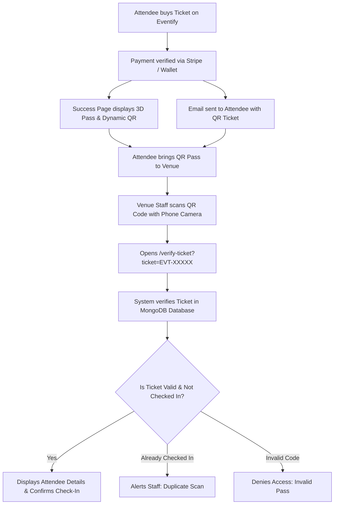

# 🎟️ Eventify — Smart Event Management & Ticket Booking Platform

[](https://nextjs.org/)
[](https://react.dev/)
[](https://tailwindcss.com/)
[](https://www.mongodb.com/)
[](https://stripe.com/)
[](https://ai.google.dev/)
[](https://eventify-tawny-one.vercel.app/)

> **Eventify** is a modern, full-stack Event Management and Ticket Booking Platform built with **Next.js 16**, **MongoDB**, **Stripe**, and **Google Gemini AI**. It delivers 3D interactive event passes, dynamic QR code check-in, real-time organizer dashboards, and an intelligent AI assistant supporting both English and Roman Urdu.

🌐 **Live Website**: [https://eventify-tawny-one.vercel.app/](https://eventify-tawny-one.vercel.app/)

---

## 🌟 Key Features

### 1. 🎫 Interactive 3D Passes & Dynamic QR Ticketing
- **3D Digital Passes**: Rendered with Three.js and custom canvas shaders featuring interactive 360° flip cards, metallic foil shimmer, and real-time attendee badges.
- **Dynamic Scannable QR Codes**: Every booked ticket automatically generates a unique verified QR code (`EVT-XXXXX`).
- **Instant Camera Verification Portal**: Attendees and venue organizers scan passes to access `/verify-ticket` for sub-2-second automated venue desk check-in.
- **Automated Email Delivery**: Tickets with scannable QR passes and venue instructions are automatically emailed via Nodemailer.

### 2. 💳 Multi-Gateway Checkout & Payments
- **Stripe Hosted Checkout**: Secure credit/debit card processing with automatic PKR-to-USD exchange rate conversion and webhook settlement.
- **Local Mobile Wallets**: Integrated support for EasyPaisa and JazzCash.
- **Direct Bank Wire**: Instant manual bank transfer instructions with invoice reference matching.

### 3. 🤖 Intelligent AI Assistant (Google Gemini)
- **Bilingual Conversations**: Understands queries and naturally responds in both **English** and **Roman Urdu**.
- **Real-Time Event Discovery**: Powered by Google's official `@google/genai` SDK to search live events, ticket pricing, dates, and locations.
- **Verified Platform Knowledge**: Provides instant assistance on booking procedures, QR check-in guidelines, and organizer tools.

### 4. 📊 Comprehensive Organizer Dashboard & Admin Portal
- **Real-time Analytics**: Track ticket sales volume, check-in percentages, gross revenue in PKR & USD, and attendee demographics.
- **Live QR Scanner & Desk Check-In**: Organizer tool to validate attendee badges at venue entrances with duplicate-entry prevention.
- **Attendee Management & Export**: View registered attendees, manage access tiers (VIP / Standard), and export attendee data to CSV/Excel.
- **Email Broadcasting**: Send bulk updates and announcements to all registered event attendees.

### 5. 🔐 Robust Authentication & Role-Based Access
- **JWT & HTTP-Only Cookies**: Secure stateless session management with HMAC-SHA256 tokens.
- **Google OAuth 2.0**: Single-click sign-in with Google Cloud credentials.
- **Password Recovery & OTP**: Safe 6-digit OTP verification via email.
- **Role Permissions**: Granular authorization for `Attendee`, `Organizer`, and `Admin`.

---

## 🛠️ Tech Stack & Architecture

| Layer | Technology | Details |
| :--- | :--- | :--- |
| **Frontend Framework** | **Next.js 16.2 (App Router)** | React 19, Server & Client Components, Turbopack |
| **Styling & Design** | **Tailwind CSS v4** | CSS Variables, Dark/Light Mode with `next-themes`, Glassmorphism |
| **3D & Animations** | **Three.js & Lucide Icons** | Interactive 3D scene canvas, Framer Motion, GSAP |
| **Database** | **MongoDB Atlas** | Official `mongodb` & `mongoose` drivers with serverless connection pooling |
| **Payment Gateway** | **Stripe API** | Hosted Checkout Sessions, Webhooks, USD/PKR dynamic conversion |
| **Artificial Intelligence**| **Google Gemini AI** | Official `@google/genai` SDK, Function Calling, System Instructions |
| **Email Service** | **Nodemailer** | SMTP transport with HTML email templates and dynamic QR image attachments |
| **Authentication** | **Custom JWT + Google OAuth** | BcryptJS password hashing, HTTP-Only cookies, Google Identity Services |
| **Hosting & CI/CD** | **Vercel** | Edge network, Serverless API functions |

---

## 📁 Project Structure

```text
eventify/
├── public/                 # Static assets, logos, and illustrations
├── src/
│   ├── app/                # Next.js App Router
│   │   ├── admin/          # Admin portal (roles, users, analytics, settings)
│   │   ├── api/            # Serverless backend API routes
│   │   │   ├── auth/       # Login, register, Google OAuth, OTP verification
│   │   │   ├── chat/       # Gemini AI Chatbot server-side endpoint
│   │   │   ├── events/     # Events CRUD, checkout, send-ticket
│   │   │   ├── organizer/  # Analytics, broadcast, check-in, attendees
│   │   │   ├── stripe/     # Stripe sessions, webhooks
│   │   │   └── verify-ticket/ # Real-time ticket verification & check-in
│   │   ├── auth/           # Login, Signup, Forgot password pages
│   │   ├── dashboard/      # Organizer management dashboard
│   │   ├── events/         # Events listing, details [id], checkout & success
│   │   ├── portal/         # Organizer creation portal
│   │   ├── verify-ticket/  # Public QR pass verification scanner
│   │   ├── layout.js       # Root layout with theme provider & chatbot
│   │   └── page.js         # Landing page with 3D pass hero & featured events
│   ├── components/         # Reusable UI components
│   │   ├── ui/             # Buttons, inputs, badges, dialogs
│   │   ├── Chatbot.js      # Gemini AI assistant widget
│   │   ├── Eventify3DScene.jsx # Three.js interactive 3D event pass
│   │   ├── Navbar.jsx      # Navigation bar with auth status & theme toggle
│   │   └── theme-toggle.jsx # Dark/Light theme switcher
│   └── lib/                # Core utilities and backend libraries
│       ├── auth.js         # JWT creation, verification, cookie helpers
│       ├── db.js           # Database CRUD abstraction & seed fallback
│       ├── email.js        # Nodemailer ticket email dispatcher
│       ├── gemini.js       # Google Gemini client configuration
│       ├── mongodb.js      # MongoDB Atlas client singleton & URI sanitizer
│       └── stripe.js       # Stripe SDK client initialization
├── .env                    # Environment variables (do NOT commit secrets)
├── package.json            # Project dependencies and scripts
└── tailwind.config.js      # Tailwind styling configuration
```

---

## ⚙️ Environment Configuration

Create a `.env` or `.env.local` file in the root directory and add the following keys:

```env
# Application URL
NEXT_PUBLIC_APP_URL=https://eventify-tawny-one.vercel.app

# MongoDB Atlas Connection
MONGODB_URI=mongodb+srv://<username>:<password>@cluster0.fbjmeqo.mongodb.net/eventify?retryWrites=true&w=majority

# Nodemailer / Email Service (Gmail SMTP)
EMAIL_USER=your_email@gmail.com
EMAIL_PASSWORD=your_gmail_app_password

# Google OAuth 2.0 Credentials
NEXT_PUBLIC_GOOGLE_CLIENT_ID=your_google_client_id.apps.googleusercontent.com

# Stripe Payment Gateway
STRIPE_SECRET_KEY=sk_test_...
NEXT_PUBLIC_STRIPE_PUBLISHABLE_KEY=pk_test_...
STRIPE_WEBHOOK_SECRET=whsec_...

# Google Gemini AI API Key
GEMINI_API_KEY=your_gemini_api_key

# JWT Secret (Optional, has default fallback)
JWT_SECRET=your_super_secret_jwt_key
```

> [!NOTE]
> For Gmail SMTP, generate an **App Password** from your Google Account settings (Security → 2-Step Verification → App Passwords).

---

## 🚀 Getting Started Locally

### 1. Clone the Repository
```bash
git clone https://github.com/ABDROJR20/eventify.git
cd eventify
```

### 2. Install Dependencies
```bash
npm install
```

### 3. Run the Development Server
```bash
npm run dev
```

Open [http://localhost:3000](http://localhost:3000) in your browser.

### 4. Build for Production
To test the production bundle locally:
```bash
npm run build
npm run start
```

---

## 🛡️ Verification & Venue Check-In Flow



---

## 🌐 Deploying to Vercel

1. Push your repository to **GitHub**.
2. Go to [Vercel Dashboard](https://vercel.com/) and click **Add New Project** → Import `eventify`.
3. In **Settings → Environment Variables**, add:
   - `NEXT_PUBLIC_APP_URL`
   - `MONGODB_URI`
   - `EMAIL_USER`
   - `EMAIL_PASSWORD`
   - `STRIPE_SECRET_KEY`
   - `NEXT_PUBLIC_STRIPE_PUBLISHABLE_KEY`
   - `STRIPE_WEBHOOK_SECRET`
   - `GEMINI_API_KEY`
   - `NEXT_PUBLIC_GOOGLE_CLIENT_ID`
   - `JWT_SECRET`
4. Click **Deploy**. Vercel will automatically build and publish your project!

---

## 🤝 Contributing

Contributions, bug reports, and feature suggestions are welcome!
1. Fork the Project
2. Create your Feature Branch (`git checkout -b feature/AmazingFeature`)
3. Commit your Changes (`git commit -m 'Add some AmazingFeature'`)
4. Push to the Branch (`git push origin feature/AmazingFeature`)
5. Open a Pull Request

---

## 📄 License

This project is licensed under the **MIT License**.

Developed with ❤️ by **Abdullah Munawar** & the Eventify Team.
